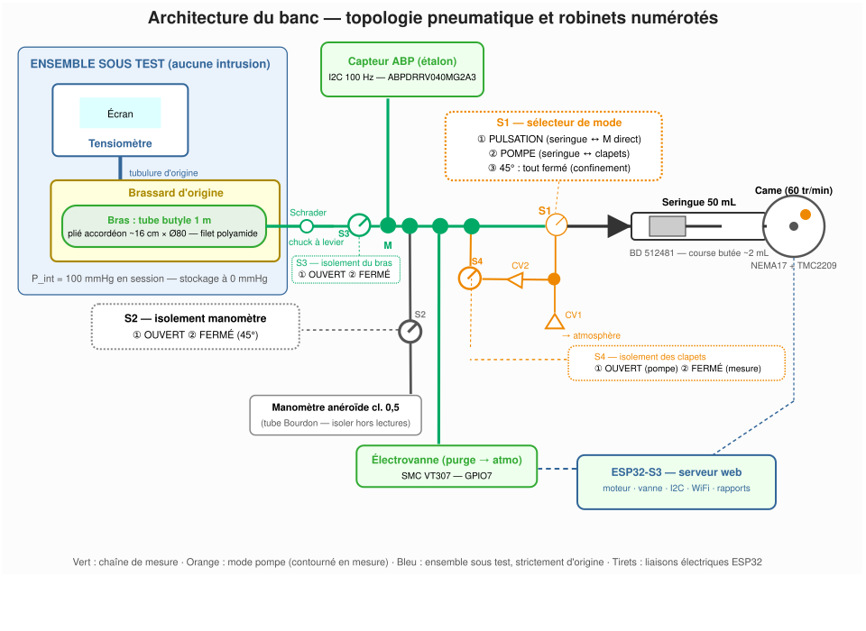
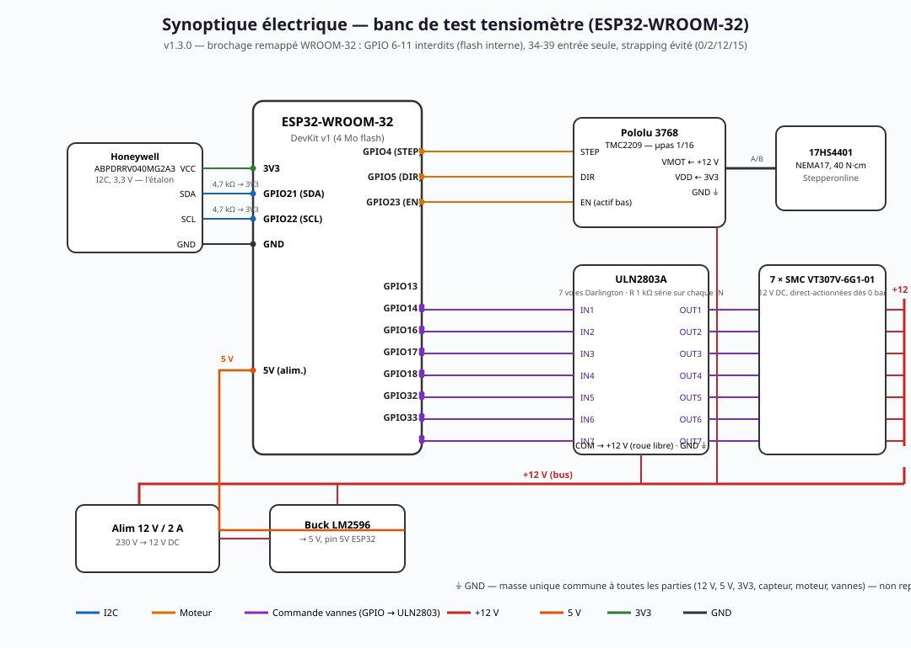

# Automated test bench — drift monitoring of a blood pressure monitor + cuff assembly

**Principle**: check the drift over time of the monitor + cuff assembly by submitting it to a **rigorously reproducible** mechanical stimulus — an artificial "arm" whose parameters do not age. An identical stimulus must produce an identical response: any variation over time = drift of the assembly under test.

**Requirements**: fully automated bench, reliable for **10+ years**, **with no component replacement** (sole exception: periodic recalibration of the reference sensor, an external operation).

> The diagrams in `docs/` are labeled in French; the tables and text below are complete in English.

---

## 1. Mechanics

### 1 a/ Artificial arm — testing the complete monitor + cuff assembly

- **T-tap between the monitor and the cuff**: rejected — the device would be tested outside its original configuration (modified circuit, extra volumes, bench leak risks).
- **Artificial arm placed inside the cuff**: retained. The monitor and its cuff stay strictly original and operate in a closed loop, exactly as on a patient. Oscillations are born *inside* the cuff and detected by the device's own sensor. Reproducibility comes from the **geometric and mechanical stability of the artificial arm**. This reproduces the real physics of oscillometry — the device is tested in its nominal domain, the one of its clinical validation.

### 1 b/ Arm material

Candidates examined: PET bottle (too rigid — 3× too fast deflation), latex balloon (replaced every 6 months — fails the 10-year requirement), platinum silicone bulb (gas permeability 10-25× butyl), Omron cuff bladder (flat shape), EPDM membrane accumulator (bulky, costly). **Retained: 700c butyl bike inner tube** — compliant (~0.1-0.3 mL/mmHg, comparable to an arm segment), **the most stable and gas-tight elastomer**, no creep when stored uninflated, original Schrader valve for sealing.

**Form-holding textile sleeve**: braided polyamide sleeve Ø 80-100 mm (Techflex F6 type): the geometry is set by the sleeve, not the elastomer. **No foam by default** (the most perishable part — the "zero consumable" architecture avoids it). **Optional EPDM foam** (not PE): if the ABP signal looks too "square" (rise/fall time ratio > 1.8, computed by the firmware), add one 3 mm closed-cell EPDM wrap between sleeve and cuff, and log the change. Markers: cuff position on the sleeve and number of Velcro notches, identical at every session.

### 1 c/ Drive: syringe + eccentric cam (retained)

- Pure positional drive: every oscillation is a deterministic piston position; amplitude is fixed by a **mechanical stop**, not by software.
- No elastic part in the drive chain: stepper → cam → bearing → rigid piston.
- Durability: stepper + bearings + screws >> 10 years (silicone grease is maintenance, not replacement). 60 rpm = one cam cycle per second = **1 Hz pseudo-heartbeats (60 bpm)**.

Rejected alternatives: rotary servo (backlash, hysteresis), linear servo, peristaltic pump (aging tube), proportional valve (cost, pilot air).

---

## 2. Pneumatics — sizing

### 2 a/ Static and dynamic pressures

- **Internal static pressure**: at the start of each session the butyl arm is inflated to **P_int = 100 mmHg** (mean arterial pressure of the nominal 120/80 case). **Storage between sessions at 0 mmHg** (deflated, Schrader valve closed): no permanent stress, no creep, no thermal drift of a pressurized volume to monitor. This creates the real physics of oscillometry: envelope maximum centered on 100 mmHg, with shoulders toward systolic and diastolic — exactly like a real arm.
- **Dynamic pressure**: the cam injects a pulsed ΔV, transmitted to the cuff through the butyl wall + sleeve (+ optional EPDM foam). Target: **2-4 mmHg at the cuff**.
- **Pressurization**: automatic, syringe in **pump mode** (§ 3), motor stopped at 100 ± 2 mmHg read by the ABP sensor, cross-checked with the aneroid gauge (stopcock S2). Ambient temperature logged every session (~0.4 mmHg/°C gas drift).

### 2 b/ Calculations

- 1 m butyl tube folded accordion-style: ~16 cm × Ø 80 mm (~6 strands), **V_arm ≈ 120-160 mL**.
- **Boyle measurement (retained value)**: inject a known ΔV (10 mL calibration syringe on port S2), read ΔP on the ABP sensor: V_arm = P_abs × ΔV / ΔP, average of three injections; effective all-inclusive volume, logged on the arm's card.
- Total volume ≈ **155 mL** (arm ~150 + tubing ≤ 4 + fittings ~1).
- Internal oscillation (isothermal): ΔP_arm = 860 × 2 / 155 ≈ **11 mmHg** for a 2 mL cam stroke.
- Transmission: k = C_wall / (C_cuff + C_wrap) ≈ 0.15-0.4 → **1.7-4.5 mmHg at the cuff** (target 2-4 ✓). k is measured at commissioning and the cam stroke adjusted (typically 2 mL); once the stop is locked, k is constant by construction.
- Device deflation: effective gas volume ≈ 135 mL, compliance comparable to a real arm → nominal deflation speed.

Waveform: the butyl wall + sleeve naturally round the edges — no additional pneumatic RC filter. "Squareness" is continuously quantified by the firmware (rise/fall ratio; alert if > 1.8 → EPDM foam).

---

## 3. Architecture



### 3 a/ Official valve numbering

| Valve | ① | ② | ③ |
| --- | --- | --- | --- |
| **S1** (mode selector, 3-way) | **PULSATION**: syringe ↔ node M direct (measurement) | **PUMP**: syringe ↔ check-valve branch (inflation) | **45°**: all closed |
| **S2** (gauge, 2-way) | **OPEN**: gauge connected to node M | **CLOSED**: gauge isolated | — |
| **S3** (arm isolation, 2-way) | **OPEN**: arm ↔ bench | **CLOSED**: arm fully isolated | — |
| **S4** (check-valve isolation, 2-way) | **OPEN**: CV2 line ↔ M (pump mode only) | **CLOSED**: check valves fully out of circuit | — |

**Configuration matrix**:

| Operation | S1 | S2 | S3 | S4 |
| --- | --- | --- | --- | --- |
| Inflation (pump) | ② | ② | ① | ① |
| Pulsation / measurement | ① | ② | ① | ② |
| Syringe ↔ sensor test (bench only) | ① | ② | **②** | ② |
| Arm-only leak test | ③ | ② | ① | ② |
| Gauge cross-readings | — | ① | ① | — |
| Boyle volume (calibration syringe on S2 port) | ③ | ① | ① | ② |
| Storage | ③ | ② | ② | ② |

- **S1 ① + S3 ②**: closed loop syringe + ABP sensor + node M **without the arm** — bench chain test (zero, leak) or holding P_int on the bench side without communication with the arm.
- **S3 ① + S1 ③**: isolates the syringe and leak-tests the arm + line alone.

### 3 b/ Stopcocks

- **S1** — syringe mode selector: ① PULSATION (measurement), ② PUMP (inflation via check valves), ③ 45° (syringe isolated).
- **S2** — gauge isolation: ① OPEN for cross-readings (the aneroid then measures exactly the same pressure as the ABP sensor — the two standards watch each other); ② CLOSED otherwise (the Bourdon tube otherwise adds parasitic volume and compliance).
- **S3** — arm isolation: ① OPEN in normal use; ② CLOSED fully decouples the arm from the bench.
- **S4** — check-valve isolation: ① OPEN only in PUMP mode; ② CLOSED otherwise. Without S4, the CV2 line would remain connected to node M even in PULSATION: extra dead volume and a check valve exposed to the oscillations — a 2-4 mbar cracking ≈ 2-3 mmHg is the same order as the 5 mmHg useful signal and would absorb/distort the pulses.

### 3 c/ How the syringe inflates the arm — check valves

In PULSATION the piston only oscillates: no net displacement. Two low-pressure check valves (CV1, CV2) on a bypass branch, selected by S1 in PUMP mode:

```
Piston retracts (intake): atmosphere ──CV1──► branch P ──► syringe   (CV2 blocked)
Piston advances (output):  syringe ──► branch P ──CV2──► node M ──► arm  (CV1 blocked)
```

The same 60 rpm cam becomes a ~1 mL/rev ≈ 60 mL/min pump: the arm reaches P_int in ~20-30 s, the firmware stopping the motor at the setpoint. Static plateaus in PUMP, fine purges via the solenoid valve.

Check valves: cracking **≤ 5 mbar**, never in the line during PULSATION — doubly isolated in measurement (S1 direct + S4 closed): no dead volume, no threshold part in the useful circuit. Their aging only affects inflation speed, with no metrological impact.

### 3 d/ Tube ↔ butyl connection

Purely pneumatic, no mechanical contact between bench and arm: silicone tubing (≤ 30 cm) ending in a **lockable lever Schrader chuck** (quality brass) clipped on the tube's original valve. **The Schrader valve re-seals the arm by itself** — it can be stored disconnected. The syringe is chassis-mounted: no parasitic force on the tube.

### 3 e/ Does the Schrader valve disturb the oscillation? — No, at our flow rates

- **Dynamic restriction**: open valve (core depressed) = Ø ~2.5 mm short passage. ~2 mL per beat at 1 Hz → peak flow ~2 mL/s → **dynamic pressure drop < 0.1 mmHg**: negligible against a 5 mmHg signal.
- **Spring-loaded core dynamics**: natural frequency in the hundreds of Hz; our 1 Hz pulses are quasi-static for it. No resonance, no chattering.
- **Dead volume**: ~0.2 mL, 0.1% of V_arm.
- **The real risk — the opening threshold**: if the chuck does not fully depress the core, the valve remains a spring check valve (opening pressure of tens of mbar) and would clip the oscillations. Two safeguards: (1) a **quality metal lever chuck** that fully depresses and holds the core; (2) a **commissioning check**: amplitude with the chuck vs a direct Luer connection (core removed) — same amplitude = no disturbance, result logged.
- **Do not remove the core routinely**: without a core, the arm no longer seals itself on disconnection — 0 mmHg storage would require pinching the tube (a permanent stress to avoid). **Keep the core**, quality chuck, initial verification.

Measurement chain: the ABP sensor measures the **arm pressure** (standard); the device measures **its own cuff pressure**. Comparing both over time reveals the drift of the assembly under test, the stimulus being identical session after session.

### 3 f/ Automation variant — 2/2 solenoid valves instead of stopcocks

The manual stopcocks S1-S4 can be replaced by ESP32-driven solenoid valves: no manual pneumatic gesture left, configuration matrix executed and logged by the firmware. Full details: [docs/automatisation-electrovannes.md](docs/automatisation-electrovannes.md).

**Selection constraint — direct-acting from 0 bar**: the circuit tops out at ~300 mmHg (**0.04 MPa**). Pressure-assisted valves (2W, 2V130, 3V, 4V series — minimum 0.02-0.15 MPa) would never open: excluded. Comparison:

| Valve | Principle | Min pressure | Verdict |
| --- | --- | --- | --- |
| **2V025-06** (AirTAC and clones) | **direct** poppet, 2.5 mm orifice, G1/8 | **0 MPa** ✅ | **Retained** — budget (~€10) |
| 2V130-15 | **pilot-diaphragm** | ~0.05 MPa ❌ | Excluded |
| 2W025-06 | diaphragm | ~0.02 MPa (150 mmHg) ❌ | Excluded — fails at low pressure (purge to 0, Boyle) |
| 3V210-08 (3/2) | pressure-assisted | 0.15 MPa ❌ | Excluded |
| **SMC VT307 / VT307V** | **direct** poppet, 0 → 0.7 MPa | **0 MPa** ✅ | **Retained** — premium (~€30-50) |

VT307 details: `3G1/4G1/5G1/6G1` = port size (Rc 1/8 → 1/2 — take **3G1**); `-01/-02` suffix = **orifice diameter** (small/large — take -01, Ø 2 mm, ample for 2 mL/s); `VT307V` = **vacuum spec** with reduced internal leakage — recommended in the measurement path; `VT307W` = V + energy-saving; `VT307E` = continuous duty. Advantage: **universal porting** — the same valve is wired NC or NO depending on plumbing, one stock reference.

**7-valve architecture** (S1 emulated by 2 valves; a single 3/2 cannot realize the three states):

| Valve | Type | Role | Power loss |
| --- | --- | --- | --- |
| V0 | NO | in series on the syringe supply (closed = S1 45°) | open — harmless (Schrader seals the arm) |
| V1 | NO | syringe ↔ node M (PULSATION) | open — **zero watt during measurement** |
| V2 | NC | syringe ↔ check-valve branch (PUMP) | closed ✅ |
| V3 | NC | gauge ↔ M (S2) | closed ✅ |
| V4 | NC | arm ↔ bench (S3) | closed ✅ (safe state) |
| V5 | NO | CV2 line ↔ M (S4) | closed ✅ |
| V6 | NC | atmosphere purge | closed ✅ |

The "all closed" storage configuration becomes the default state on power loss. Firmware: `valves.h/.cpp` module (`valvesApply()`, `valveLeakTest()`).

**Watch points**: V1 sits in series in the oscillation path (negligible restriction and dead volume, absorbed in the Boyle measurement; its seat is a potential leak surface → isolation self-test at every session, slope < 1 mmHg/min); 10-year requirement: buy **3-4 spare valves** (NBR seal/coil without manufacturer warranty); drive via a **ULN2803** (7 Darlington channels); G1/8 fittings → Luer/4 mm tube adapters.

**Bottom line**: +€60-90 (on par with stainless stopcocks) in exchange for fully automated procedures and configuration traceability.


---

## 4. Electronic wiring



```
ABP sensor (I2C, 3.3 V)         ESP32-S3
  VCC ────────── 3V3
  GND ────────── GND
  SDA ──[4.7k to 3V3]── GPIO8
  SCL ──[4.7k to 3V3]── GPIO9

TMC2209 (stepper)
  STEP ────────── GPIO4
  DIR  ────────── GPIO5
  EN   ────────── GPIO6 (active low)
  VMOT ────────── +12 V | GND ─ common ground | VDD ─ 3V3
  Microstepping 1/16

12 V solenoid valve
  GPIO7 ── R 1 kΩ ── TIP120 base ; emitter GND ; collector → valve
  other valve terminal → +12 V ; 1N4007 flyback diode
```

Watch out: TMC2209 logic at 3V3; single common ground for all parts. Solenoid-valve variant: replace the 7 TIP120 stages with a **ULN2803** (7 Darlington channels, identical input pinout).

---

## 5. Bill of materials

### 5 a/ Mechanics

| Qty | Part | Description |
| --- | --- | --- |
| 1 | **17HS4401** | NEMA17 stepper, 40 N·cm |
| 1 | **Pololu 3768 (TMC2209)** | Silent stepper driver |
| 2 | **GT2-20T** + 200 mm belt | Cam/motor transmission |
| 1 | — | Ø70 mm cam disc, adjustable eccentric (oblong slot) |
| 2 | **625ZZ** | Ball bearings (one embedded in the piston head) |
| 1 | **BD 512481** | 50 mL Luer-Lok syringe |
| 1 | — | M4 screw + locknut (adjustable travel stop) |
| 1 | — | Drilled aluminum chassis / 2020 profile |
| 1 | — | Silicone grease (annual maintenance) |
| 1 | — | Verified **class 0.5 aneroid gauge** (Riester Big Ben precision or Welch Allyn) |

**Artificial arm**: 700c butyl inner tube cut to 1 m (~5 €); braided polyamide sleeve Ø 80-100 mm (Techflex F6, 1 m); *(optional)* 3 mm closed-cell EPDM foam; hose clamps + permanent marker.

### 5 b/ Pneumatics

| Qty | Description |
| --- | --- |
| 1 | **Lockable lever Schrader chuck** (brass) — quick bench ↔ butyl tube connection |
| 1 | Original Schrader valve of the butyl tube (seal, 0 mmHg storage) |
| 1 | 3-way Luer stopcock: **S1** syringe mode selector |
| 3 | 2-way Luer stopcocks: **S2** (gauge isolation), **S3** (arm isolation), **S4** (check-valve isolation) |
| 2 | Low-pressure Luer check valves (cracking ≤ 5 mbar): CV1 (intake), CV2 (output) |
| 1 | 4×7 mm silicone tubing (30 cm max) — or semi-rigid PU/PA if edges too soft |
| 3 | Luer T-fittings |
| *(Automated variant, § 3 f)* | **7 direct-acting 2/2 solenoid valves from 0 bar** (2V025-06 or SMC VT307V-3G1-01) + **ULN2803** — replace S1-S4 |
| 1 | 12 V miniature 2/2 solenoid valve (**SMC VT307-5G-01**) |
| 1 | **10 mL Luer-Lok calibration syringe** (Boyle measurement, on the free S2 port) |

### 5 c/ Electronics

| Qty | Part | Description |
| --- | --- | --- |
| 1 | **ABPDRRV040MG2A3** | Honeywell ABP 0–40 kPa (0–300 mmHg), I2C, ±0.25% FS — **the bench standard** |
| 1 | **ESP32-S3-DevKitC-1-N8R2** | Native 3.3 V MCU, WiFi |
| 2 | — | 4.7 kΩ resistors (I2C pull-ups) |
| 1 | — | **TIP120** + 1 kΩ + **1N4007** (valve drive) |
| 1 | — | 12 V / 2 A supply + **LM2596** buck |
| 1 | — | 470 µF capacitor |

**Standard traceability**: the ABP sensor must be **recalibrated by an accredited lab every ~2 years** (~80-120 €) — the only recurring operation, external, no component replacement. ABP family drift: < 0.5% FS/year.

---

## 6. Indicative budget

| Item | Cost |
| --- | --- |
| Mechanics | €60–85 |
| Artificial arm | €15–25 |
| Verified class 0.5 aneroid gauge | €50–90 |
| Electronics | €70–100 |
| Pneumatics | €25–40 |
| Initial ABP calibration | €80–120 (once) |
| ABP recalibration every 2 years | €40–60 / operation |
| **Total investment** | **≈ €300–460** |

---

## 7. Software — ESP32_Software

The ESP32 hosts a **local web interface** (the bench creates its own WiFi network `Banc-Tensiometre`, password `Banc10ans!`). Four functions:

1. **Real-time status**: current pressure, amplitude and shape of the last pulse, motor/valve state.
2. **Step-by-step self-calibration procedure** (§ 8 a): the bench runs the automatic part and **requests user approval for every manual gesture** (S1-S4 positions, chuck, cuff) — the motor is blocked until confirmation.
3. **Test procedure** (§ 8 b): guidance of the 5 measurements, entry of the values displayed by the monitor.
4. **PDF report**: form (operator, temperature, serial number, firmware, gauge readings, 5 values) → PDF generated **browser-side** (jsPDF — an ESP32 cannot natively produce a PDF) and downloaded locally.

Firmware layout (see [ESP32_Software/](ESP32_Software/)):

```
ESP32_Software/
├── BloodPressureBench.ino   # Entry point: setup() / loop()
├── config.h                 # Pinout, constants, WiFi credentials
├── peripherals.h/.cpp       # Device management: ABP sensor, motor, valve, 100 Hz acquisition
├── procedure.h/.cpp         # Procedure engine: self-diagnostic and test steps
├── valves.h/.cpp           # Solenoid valves (variant § 3 f): configuration matrix, isolation self-test
├── web_server.h/.cpp        # Web server: REST API, static files
└── www/
    ├── index.html           # Web UI (status, approval modals, form)
    └── report.js            # PDF report generation (jsPDF, browser-side)
```

---

## 8. Protocol

### 8 a/ Bench self-diagnostic (before every session)

> **Automated variant (§ 3 f)**: every configuration below is applied automatically by the firmware (`valvesApply()`), and each valve passes an **isolation self-test** (`valveLeakTest()`, slope < 1 mmHg/min) before the session — manual approvals then cover only physical assembly (cuff, chuck, calibration syringe).

Valve states — **S1**: ① PULSATION / ② PUMP / ③ 45°; **S2**: ① OPEN / ② CLOSED; **S3**: ① OPEN / ② CLOSED (arm isolation); **S4**: ① OPEN / ② CLOSED (check-valve isolation).

1. **Assembly and pressurization**: arm on sleeve (markers aligned), chuck locked, **S3 ① OPEN**, **S1 ② PUMP**, **S4 ① OPEN**, S2 ② CLOSED. The motor pumps through the check valves (~60 mL/min), automatic stop at **P_int = 100 ± 2 mmHg**. Cross-check: S2 ① OPEN, aneroid reading logged. S2 ② CLOSED, **S1 ① PULSATION**.
2. **Leak test — two separate tests**: motor stopped, 60 s at 150 mmHg on the ABP sensor, **slope < 1 mmHg/min** required. a) *Bench only*: **S3 ② CLOSED**; b) *Arm only*: **S1 ③ (45°) + S3 ① OPEN**. Compare both slopes to locate any leak.
3. **Standard linearity**: 50 / 100 / 150 mmHg plateaus — ramp in PUMP (S1 ②, S4 ①), fine purge via the solenoid valve; at each plateau, S2 ① OPEN, ABP/aneroid cross-reading.
4. **Boyle volume**: **S1 ③ + S2 ① + S3 ① + S4 ②**, 10 mL calibration syringe on the S2 port: inject 10 mL, read ΔP, V_arm = P_abs × ΔV / ΔP, compare with the arm card. Disconnect, S2 ② CLOSED.
5. **Amplitude and shape calibration** (commissioning, then annual check): **S1 ① + S4 ②**, motor running — internal peak-to-peak amplitude target **8-12 mmHg** (→ 2-4 mmHg at the cuff), **shape ratio 0.7-1.3**. Adjust the cam stop (typical stroke 2 mL) and lock it. If ratio > 1.8: EPDM foam. *At commissioning only*: redo with a direct Luer connection (core removed) — same amplitude = the Schrader valve does not disturb (§ 3 e).

### 8 b/ Test run

1. Full self-diagnostic, arm at **P_int = 100 mmHg**, **S1 ① + S4 ② + S3 ①**, S2 ②, motor running (60 bpm).
2. Start the 100 Hz acquisition, **then** the measurement on the monitor (it inflates its cuff, detects the arm's 60 bpm, deflates, displays).
3. Record the displayed value + device firmware version.
4. Repeat **5 times** (30 s intervals).
5. **End of session**: motor stopped, S1 ③, S3 ①, solenoid valve open until **0 mmHg**, valve closed. Unlock the chuck (the Schrader valve re-seals the arm). **Storage: S1 ③, S2 ②, S3 ②, S4 ②** — arm at 0 mmHg, no permanent stress.

### 8 c/ Drift indicators

Sessions 3-6 months apart, same temperature ±2 °C:

| Indicator | Computation | Alert if |
| --- | --- | --- |
| Bench leak | slope at 150 mmHg | > 1 mmHg/min |
| Standard drift | ABP vs gauge deviation at 3 plateaus | deviation grows > 0.5 mmHg cumulative |
| Intra-session dispersion | std deviation of the 5 values | increases > 50% vs session 1 |
| System accuracy drift | mean of the 5 values vs session 1 | monotonic drift **> 3 mmHg cumulative** |
| Dynamic response | envelope of internal oscillations | position/amplitude change without identified cause |

**Interpretation**: a monotonic drift of the displayed mean with a stable stimulus and standard = **drift of the monitor + cuff assembly**. To attribute it, swap the cuff with a new identical one: if the drift follows the cuff → bladder; if it stays with the device → electronics/valve.

---

## 9. Limits and critical analysis

1. **A single "patient"**: one nominal point (100 mmHg, 60 bpm, one amplitude). We look for drift, not the complete error map. Possible extension: a second tube sealed at 120 mmHg ("hypertensive patient").
2. **Mechanical coupling not computable**: everything is protocolized to make the transmission *constant*, but it is *unknown in absolute value* — the bench measures relative evolutions, never absolute accuracy.
3. **The standard drifts too**: mitigations = accredited recalibration every 2 years + cross-control chart with the aneroid gauge (two independent standards watching each other).
4. **Butyl still ages, slowly**: stored at 0 mmHg it lasts well beyond 10 years; the leak test detects any micro-leak; visual inspection at every session (cracks on the folds).
5. **Check valves = the only soft active parts**: doubly isolated during measurement (S1 + S4), their drift only affects inflation speed.
6. **Thermal sensitivity**: ~0.4 mmHg/°C during a session — temperature logged, ±3 °C range vs the reference session.
7. **No clinical validation**: the bench answers "has it drifted?", never "is it accurate?". Keep the annual comparison with a validated monitor.
8. **Device firmware**: an algorithm update can change the response without hardware drift — log the device firmware version in every session sheet.
9. **Strengths**: no elastic consumable in the drive chain (metal, bearings, air); mechanically defined stimulus (stop + cam), reproducible by construction; two cross-checked standards; the assembly under test operates strictly as original.
