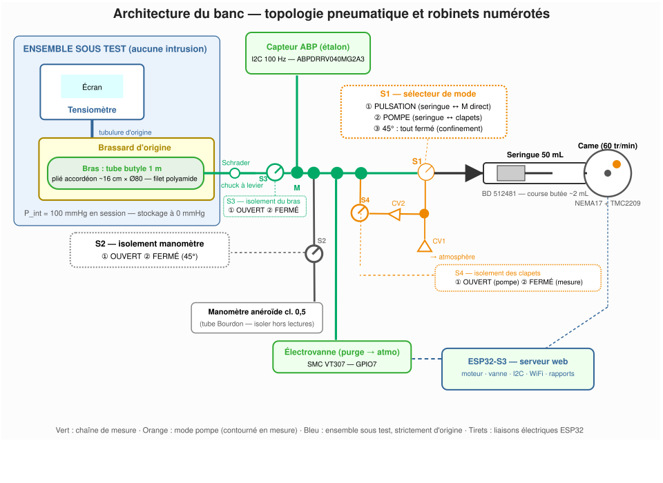
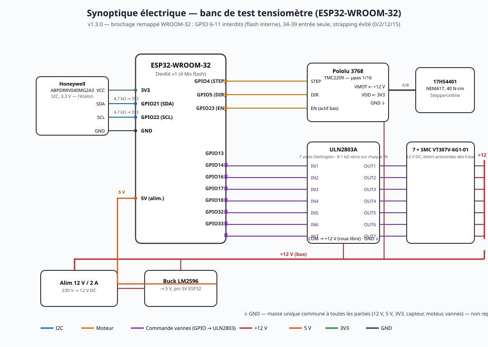

# Banc de test automatisé — suivi de dérive d'un ensemble tensiomètre + brassard

**Principe** : vérifier la dérive dans le temps de l'ensemble tensiomètre + brassard, en le soumettant à un stimulus mécanique **rigoureusement reproductible** — un « bras artificiel » dont les paramètres ne vieillissent pas. Un stimulus identique doit produire une réponse identique : toute variation dans le temps = dérive de l'ensemble sous test.

| Recalibrage étalon | 0 € — remplacé par le contrôle interne des 3 étapes de départage (§ 8 a) |

---

## 1. Mécanique

### 1 a/ Choix du bras artificiel — test de l'ensemble brassard + tensiomètre

L'objectif étant de tester le **système complet appareil + brassard**, deux architectures étaient possibles :

- **Dérivation en T entre l'appareil et le brassard** : le banc s'intercale dans la ligne pneumatique. Comparaison directe banc/appareil, mais l'appareil est testé **hors de sa configuration d'origine** (circuit modifié, volumes additionnels) et le banc introduit ses propres risques de fuite. **Écarté.**
- **Bras artificiel placé dans le brassard** : l'appareil et son brassard restent strictement d'origine et fonctionnent en circuit fermé, exactement comme sur un patient. Les oscillations naissent *dans* le brassard et sont détectées par le capteur de l'appareil lui-même. La reproductibilité réside dans la **stabilité géométrique et mécanique du bras artificiel**. **Retenu.**

Ce choix reproduit la physique réelle de l'oscillométrie (§ 2 a) : l'appareil est testé dans son domaine de fonctionnement nominal, celui de sa validation clinique.

### 1 b/ Matériau du bras artificiel

| Matériau | Verdict | Raison |
| --- | --- | --- |
| Bouteille PET 50 cl | Éliminé | **Trop rigide** (compliance ~0,02-0,03 mL/mmHg) : déflation 3× trop rapide, algorithmes décrochés |
| Ballon latex (baudruche) | Éliminé | Vieillissement rapide (ozone, UV) : remplacement tous les 6 mois — contraire à l'exigence 10 ans |
| Poire silicone platiné | Éliminé | Vieillissement nul mais **perméabilité aux gaz** ~10-25× le butyle |
| Vessie de brassard Omron (nylon/TPU) | Possible, non retenu | Durée de vie excellente, mais forme plate, valve à bricoler |
| Accumulateur à membrane EPDM | Possible, non retenu | Très stable, mais encombrant, coûteux, non anthropomorphe |
| **Chambre à air butyle de vélo (700c)** | **Retenu** | Souple (compliance ~0,1-0,3 mL/mmHg), **le butyle est l'élastomère le plus stable et le plus imperméable** ; sans contrainte permanente, pas de fluage ; valve Schrader d'origine pour sceller |

**Filet textile de maintien de forme** : une chambre à air seule est tubulaire et flasque. Pour en faire un « bras » cylindrique de diamètre constant (~Ø 80-90 mm, plage 22-32 cm des brassards standards) :

- **Gaine tressée en polyamide Ø 80-100 mm** (type Techflex F6, ~10-15 €/m) : la géométrie est déterminée par le filet, pas par l'élastomère.
- **Pas de mousse par défaut** : la mousse est la pièce la plus périssable du banc — l'architecture « zéro consommable » s'en passe.
- **Option mousse EPDM** (pas PE) : si le signal mesuré au capteur ABP paraît trop « carré » (rapport temps de montée/descente > 1,8 — métrique calculée par le code embarqué), ajouter 1 tour de mousse **EPDM** 3 mm à cellules fermées entre filet et brassard, et consigner le changement.
- Repères au feutre indélébile : **position du brassard sur le filet** + **nombre de crans de scratch** — montage protocoleisé identique à chaque session.

### 1 c/ Système dynamique : seringue + disque à came (retenu)

- **Positionnisme pur** : chaque oscillation est une position mécanique déterministe du piston. L'amplitude est figée par une **butée mécanique**, pas par un réglage logiciel.
- **Aucune pièce élastique dans la chaîne d'entraînement** : moteur pas-à-pas → came → roulement → piston rigide.
- **Durabilité** : pas-à-pas + roulements + vis = durée de vie >> 10 ans. Graisse silicone à ravitailler (maintenance, pas remplacement).

Alternatives écartées : servo rotatif (jeu ±1°, hystérésis), servo linéaire (résolution, coût), pompe péristaltique PWM (tube qui vieillit), vanne proportionnelle (coût, air pilote).

**Chaîne d'entraînement** :

| Qté | Référence | Désignation |
| --- | --- | --- |
| 1 | **Stepperonline 17HS4401** | NEMA17, 40 N·cm |
| 1 | **Pololu 3768 / TMC2209** | Driver pas-à-pas, microstepping 1/256, silencieux |
| 2 | **GT2-20T** + courroie GT2 200 mm | Réduction 1:1 (ou entraînement direct) |
| 1 | — | **Disque à came** Ø 70 mm, excentrique réglable 0,5-2 mm (rainure oblongue + contre-écrou) |
| 2 | **625ZZ** | Roulements ; l'un noyé dans la tête du piston |
| 1 | **BD 512481** | Seringue 50 mL Luer-Lok ; piston découpé, roulement dans l'axe |
| 1 | — | Butée de course : vis M4 + contre-écrou |
| — | — | Graisse silicone, châssis alu percé |

Rotation à **60 tr/min** = un cycle de came par seconde = pseudo-battements à **1 Hz (60 bpm)**.

---

## 2. Pneumatique — dimensionnement

### 2 a/ Pressions : statique et dynamique

**Pression statique interne du bras** : en début de session, le contenant butyle est gonflé à **P_int = 100 mmHg** (pression artérielle moyenne du cas nominal 120/80). **Stockage entre sessions à 0 mmHg** (bras dégonflé, valve Schrader fermée) : pas de contrainte permanente, pas de fluage, pas de dérive thermique d'un volume sous pression à surveiller. Ce choix crée la physique réelle de l'oscillométrie :

- P_brassard >> P_int : bras écrasé, aucune oscillation transmise (artère occluse) ;
- P_brassard ≈ P_int : transmission maximale → maximum d'oscillations au brassard ;
- P_brassard << P_int : le bras est déjà dilaté, la transmission retombe.

L'enveloppe des oscillations vue par l'appareil présente un **maximum centré sur 100 mmHg** — exactement comme sur un vrai bras.

**Pression dynamique** : la came injecte un volume pulsé ΔV, transmis au brassard à travers la paroi butyle + filet (+ mousse EPDM éventuelle). Cible : **2 à 4 mmHg côté brassard**.

**Mise en pression** : P_int est établie automatiquement par la seringue en **mode pompe** (§ 3), arrêt du moteur à la consigne 100 ± 2 mmHg lue au capteur ABP, puis contrôle croisé au manomètre anéroïde (stopcock S2). Température ambiante consignée à chaque session (dérive thermique du gaz ~0,4 mmHg/°C).

### 2 b/ Calculs avec la configuration retenue

- Tube butyle **coupé à 1 m**, plié en **accordéon** : paquet de **~16 cm × Ø 80 mm** (≈ largeur de vessie + 2-3 cm), **~6 brins empilés** dans le filet.
- **V_bras estimé 120-160 mL** (0,4-0,5 L gonflé rond, aplati sous filet à 100 mmHg).
- **Mesure de Boyle (valeur retenue)** : injecter un ΔV connu (10 mL, seringue de calibration sur le port S2) et lire ΔP au capteur ABP : V_bras = P_abs × ΔV / ΔP. Trois injections, moyenne. V effectif **tout compris**, consigné sur la fiche du bras et re-mesuré après tout remontage.
- Volume total côté banc : V_total ≈ V_bras (~150 mL) + tubulure (≤ 4 mL) + raccords (~1 mL) ≈ **155 mL**.
- Oscillation interne (loi isotherme) : ΔP_bras = 860 × 2 / 155 ≈ **11 mmHg** pour une course de came de 2 mL.
- Transmission au brassard : k = C_paroi / (C_cuff + C_wrap) ≈ 0,15-0,4 → **1,7-4,5 mmHg côté brassard** (cible 2-4 ✓). k est **mesuré à la mise en service** et la course de came ajustée (typiquement 2 mL) ; une fois la butée figée au contre-écrou, k est constant par construction.
- Déflation de l'appareil : V_gaz effectif ≈ 120 + 15 mL, compliance comparable à un bras réel → l'appareil dégonfle à sa vitesse nominale.

**Remarque forme d'onde** : le passage par la paroi butyle + filet arrondit naturellement les fronts — pas de filtre RC additionnel. La « carréité » est quantifiée en continu par le code embarqué (rapport montée/descente ; alerte si > 1,8 → mousse EPDM).

---

## 3. Architecture



### 3 a/ Positions des robinets — numérotation officielle

| Robinet | ① | ② | ③ |
| --- | --- | --- | --- |
| **S1** (sélecteur de mode, 3 voies) | **PULSATION** : seringue ↔ M en direct (mesure) | **POMPE** : seringue ↔ branche clapets (gonflage) | **45°** : tout fermé (confinement) |
| **S2** (manomètre, 2 voies) | **OUVERT** : manomètre raccordé au nœud M | **FERMÉ** : manomètre isolé | — |
| **S3** (isolement du bras, 2 voies) | **OUVERT** : bras ↔ banc | **FERMÉ** : bras isolé du banc | — |
| **S4** (isolement des clapets, 2 voies) | **OUVERT** : ligne CV2 ↔ M (mode pompe uniquement) | **FERMÉ** : clapets totalement hors circuit | — |

**Matrice des configurations** :

| Opération | S1 | S2 | S3 | S4 |
| --- | --- | --- | --- | --- |
| Gonflage (pompe) | ② | ② | ① | ① |
| Pulsation / mesure | ① | ② | ① | ② |
| Test seringue ↔ capteur (banc seul, sans bras) | ① | ② | **②** | ② |
| Étanchéité du bras seul | ③ | ② | ① | ② |
| Lectures croisées manomètre | — | ① | ① | — |
| Volume (Boyle, seringue de calibration sur le port S2) | ③ | ① | ① | ② |
| Stockage | ③ | ② | ② | ② |

- **S1 ① + S3 ②** : boucle fermée seringue + capteur ABP + nœud M **sans le bras** — test de la chaîne banc seule (zéro, fuite), ou maintien de P_int côté banc sans communication avec le bras.
- **S3 ① + S1 ③** : isole la seringue et teste l'étanchéité du bras + ligne seule.

### 3 b/ Les robinets (stopcocks)

Convention : sur un robinet 3 voies, **le bras de la manette pointe le port fermé** ; le flux passe entre les deux autres ports. Position **45°** = tout fermé.

- **S1 — sélecteur de mode seringue** : ① PULSATION (mesure), ② POMPE (gonflage via clapets), ③ 45° (seringue isolée).
- **S2 — isolement du manomètre** : ① OUVERT pour les lectures croisées (l'anéroïde mesure exactement la même pression que le capteur ABP — contrôle mutuel des deux étalons) ; ② FERMÉ le reste du temps (le tube Bourdon ajoute sinon volume et compliance parasites).
- **S3 — isolement du bras** : ① OUVERT en usage normal ; ② FERMÉ découple totalement le bras du banc.
- **S4 — isolement des clapets** : ① OUVERT uniquement en mode POMPE ; ② FERMÉ dans toute autre position. Sans S4, la ligne CV2 resterait raccordée au nœud M même en PULSATION : volume mort et clapet exposé aux oscillations — un cracking de 2-4 mbar ≈ 2-3 mmHg est du même ordre que le signal utile de 5 mmHg et **absorberait/déformerait les pulses**.

### 3 c/ Comment la seringue gonfle le bras — les clapets anti-retour

En PULSATION, le piston oscille sans déplacement net : impossible de gonfler. Solution : **deux clapets anti-retour (CV1, CV2) sur une branche de contournement**, sélectionnée par S1 en position POMPE :

```
Piston recule (aspiration) : atmosphère ──CV1──► branche P ──► seringue   (CV2 bloqué)
Piston avance (refoulement) : seringue ──► branche P ──CV2──► nœud M ──► bras  (CV1 bloqué)
```

La même came à 60 tr/min devient un **pompage de ~1 mL/tour ≈ 60 mL/min** : le bras atteint P_int en ~20-30 s, le code arrêtant le moteur à la consigne. Paliers en POMPE, purges fines à l'électrovanne.

**Critique des clapets** : cracking **≤ 5 mbar**, et ils ne doivent **jamais** se trouver dans la ligne en mode PULSATION. C'est le rôle combiné de S1 (seringue en direct) **et de S4 ②** (ligne CV2 déconnectée) : en mesure, les clapets sont **doublement isolés** — aucun volume mort ni pièce à seuil dans le circuit utile. Leur vieillissement éventuel n'affecte que la vitesse de gonflage, sans incidence métrologique.

### 3 d/ Liaison tuyau ↔ butyle

Liaison **purement pneumatique, aucun contact mécanique** entre le banc et le bras : tubulure silicone (≤ 30 cm) aboutissant à un **chuck de valve Schrader à levier verrouillable** (laiton de qualité) clipsé sur la valve d'origine du tube butyle. **La valve Schrader referme le bras toute seule** — stockage déconnecté possible sans fuite. La seringue est fixée au châssis : aucune force parasite sur le tube.

### 3 e/ La valve Schrader perturbe-t-elle l'oscillation ? — Non, à nos niveaux de débit

- **Restriction dynamique** : valve ouverte (noyau enfoncé) = passage Ø ~2,5 mm très court. Oscillation ~2 mL à 1 Hz → débit de pointe ~2 mL/s → **chute de pression dynamique < 0,1 mmHg** : négligeable devant un signal de 5 mmHg.
- **Dynamique du noyau à ressort** : fréquence propre en centaines de Hz ; nos pulses à 1 Hz sont quasi statiques pour lui. Pas de résonance, pas de claquement.
- **Volume mort** : ~0,2 mL, soit 0,1 % de V_bras — négligeable.
- **Le vrai risque — le seuil d'ouverture** : si le chuck n'enfonce pas **complètement** le noyau, la valve reste un clapet à ressort (ouverture de quelques dizaines de mbar) et écrêterait les oscillations. Deux garanties :
  1. **Chuck métallique à levier de qualité** qui enfonce le noyau à fond et le maintient ;
  2. **Vérification à la mise en service** : amplitude avec chuck vs liaison Luer directe (valve dénoyautée) — même amplitude = pas de perturbation. Résultat consigné.
- **Ne pas dénoyauter en routine** : sans noyau, le bras ne se referme plus seul à la déconnexion — le stockage à 0 mmHg deviendrait impossible sans pincer le tube (contrainte permanente à éviter). **Garder le noyau**, chuck de qualité, vérification initiale.

Chaîne de mesure : le capteur ABP mesure la **pression du bras** (étalon) ; l'appareil mesure la **pression de son propre brassard**. La comparaison dans le temps révèle la dérive de l'ensemble sous test, le stimulus étant identique de session en session.

### 3 f/ Variante d'automatisation — électrovannes 2/2 à la place des robinets

Les robinets manuels S1-S4 peuvent être remplacés par des électrovannes pilotées par l'ESP32 : plus aucun geste pneumatique manuel, matrice de configurations exécutée et journalisée par le firmware. Détails complets : [docs/automatisation-electrovannes.md](docs/automatisation-electrovannes.md).

**Contrainte de sélection — direct-actionnées dès 0 bar** : le circuit plafonne à ~300 mmHg (**0,04 MPa**). Les vannes assistées par pression (2W, 2V130, 3V, 4V — mini 0,02 à 0,15 MPa) ne s'ouvriraient jamais : exclues. Comparatif :

| Vanne | Principe | Pression mini | Verdict |
| --- | --- | --- | --- |
| **2V025-06** (AirTAC et clones) | poppet **direct**, orifice 2,5 mm, G1/8 | **0 MPa** ✅ | **Retenue** — budget (~10 €) |
| 2V130-15 | **diaphragme piloté** | ~0,05 MPa ❌ | Exclue |
| 2W025-06 | diaphragme | ~0,02 MPa (150 mmHg) ❌ | Exclue — échoue à basse pression (purge à 0, Boyle) |
| 3V210-08 (3/2) | assisté | 0,15 MPa ❌ | Exclue |
| **SMC VT307 / VT307V** | poppet **direct**, 0 → 0,7 MPa | **0 MPa** ✅ | **Retenue** — qualité (~30-50 €) |

Nomenclature VT307 : `6` = **tension 12 V DC**, `G1` = **connectique : fil 30 cm**, suffixe `-01/-02` = **diamètre d'orifice** (petit/gros — -01 = Ø 2 mm, suffisant pour 2 mL/s) ; `VT307V` = variante **spécification vide** à fuite interne réduite — recommandée sur le chemin de mesure ; `VT307W` = V + économie d'énergie ; `VT307E` = service continu. **Référence retenue (acquise à ~10 €/pièce)** : **`VT307V-6G1-01` DC 12 V**, port **Rc 1/8** natif — aucun réducteur à prévoir, raccords G1/8 → adaptateurs Luer/tuyau 4 mm. Une seule référence pour les 7 rôles, y compris la vanne de purge. Atout : **porting universel** — la même vanne se câble NC ou NO selon le branchement, une seule référence en stock.

**Architecture à 7 vannes** (S1 émulé par 2 vannes, une 3/2 ne réalisant pas les 3 états) :

| Vanne | Type | Rôle | Coupure de courant |
| --- | --- | --- | --- |
| V0 | NO | série sur l'alimentation seringue (fermée = S1 45°) | ouverte — sans risque (Schrader scelle le bras) |
| V1 | NO | seringue ↔ nœud M (PULSATION) | ouverte — **zéro watt pendant la mesure** |
| V2 | NC | seringue ↔ branche clapets (POMPE) | fermée ✅ |
| V3 | NC | manomètre ↔ M (S2) | fermée ✅ |
| V4 | NC | bras ↔ banc (S3) | fermée ✅ (état de sécurité) |
| V5 | NO | ligne CV2 ↔ M (S4) | fermée ✅ |
| V6 | NC | purge atmosphère | fermée ✅ |

La configuration de stockage « tout fermé » devient l'état par défaut à la coupure de courant. Firmware : `valves.h/.cpp` (`valvesApply()`, `valveLeakTest()`).

**Points de vigilance** : V1 est en série dans le chemin oscillant (restriction et volume mort négligeables, absorbés dans le V\_boyle ; son siège = surface de fuite potentielle → auto-test d'isolement à chaque session, pente < 1 mmHg/min) ; exigence 10 ans : acheter **3-4 vannes d'avance** (joint NBR/bobine sans garantie constructeur) ; pilotage par **ULN2803** (7 voies Darlington) ; raccords G1/8 → adaptateurs Luer/tuyau 4 mm.

**Bilan** : +≈ 80 € (7 vannes SMC à 10 €/pièce + ULN2803 + raccords G1/8), contre l'automatisation complète des procédures et la traçabilité des configurations.


---

## 4. Câblage électronique



```
Capteur ABP (I2C, 3,3 V)        ESP32-S3
  VCC ────────── 3V3
  GND ────────── GND
  SDA ──[4,7k à 3V3]── GPIO8
  SCL ──[4,7k à 3V3]── GPIO9

TMC2209 (stepper)
  STEP ────────── GPIO4
  DIR  ────────── GPIO5
  EN   ────────── GPIO6 (actif bas)
  VMOT ────────── +12 V | GND ─ masse commune | VDD ─ 3V3
  Microstepping 1/16

Électrovanne 12 V
  GPIO7 ── R 1 kΩ ── base TIP120 ; émetteur GND ; collecteur → vanne
  autre borne vanne → +12 V ; diode 1N4007 inversée aux bornes

Variante automatisée — 7 électrovannes (SMC VT307V-6G1-01, 12 V) pilotées en GPIO via ULN2803 :
  V0 = GPIO15   V1 = GPIO16   V2 = GPIO17   V3 = GPIO18
  V4 = GPIO19   V5 = GPIO21   V6 = GPIO7 (purge)
  GPIO ── R 1 kΩ ── IN1..IN7 du ULN2803 ; OUT1..OUT7 → borne basse de chaque vanne
  autre borne vanne → +12 V ; broche COM du ULN2803 → +12 V (diodes de roue libre internes)
  Brochages définis dans config.h (PIN_V0 … PIN_V6) — l'inversion logique NC/NO est dans valves.cpp
```

Points de vigilance : TMC2209 en logique 3V3 ; masse unique commune à toutes les parties. Variante électrovannes : remplacer les 7 étages TIP120 par un **ULN2803** (7 voies Darlington, brochage d'entrée identique).

---

## 5. Nomenclature

### 5 a/ Mécanique

| Qté | Référence | Désignation |
| --- | --- | --- |
| 1 | **Stepperonline 17HS4401** | Moteur pas-à-pas NEMA17, 40 N·cm |
| 1 | **Pololu 3768 (TMC2209)** | Driver pas-à-pas silencieux |
| 2 | **GT2-20T** + courroie 200 mm | Transmission came/moteur |
| 1 | — | Disque à came Ø70 mm, excentrique réglable |
| 2 | **625ZZ** | Roulements à billes |
| 1 | **BD 512481** | Seringue 50 mL Luer-Lok |
| 1 | — | Vis M4 + contre-écrou (butée réglable) |
| 1 | — | Châssis alu percé / profilé 2020 + équerres |
| 1 | — | Graisse silicone (maintenance annuelle) |
| 1 | **Riester 1456** (Big Ben **carré**, table) | Tensiomètre anéroïde — **120 €** : capsule **CuBe trempé** quasi exempte de vieillissement, tolérance **±2 mmHg** (0-300 mmHg), surcharge **600 mmHg**, dérive **< 0,5 mmHg/an** monté fixe (cause de dérive = chocs, pas la capsule) |

**Bras artificiel** : chambre à air **700c butyle** coupée à 1 m (~5 €) ; **gaine tressée polyamide Ø 80-100 mm** (Techflex F6, 1 m) ; *(option)* mousse **EPDM** 3 mm à cellules fermées ; colliers Serflex + feutre indélébile.

### 5 b/ Pneumatique

| Qté | Désignation |
| --- | --- |
| 1 | **Chuck Schrader à levier verrouillable** (laiton) — liaison rapide banc ↔ tube butyle |
| 1 | Valve Schrader d'origine du tube butyle (joint de scellement, stockage à 0 mmHg) |
| 1 | Robinet 3 voies Luer : **S1** sélecteur de mode seringue |
| 3 | Robinets 2 voies Luer : **S2** (isolement manomètre), **S3** (isolement du bras), **S4** (isolement des clapets) |
| 2 | **Clapets anti-retour Luer basse pression** (cracking ≤ 5 mbar) : CV1 (admission), CV2 (refoulement) |
| 1 | Tuyau silicone 4×7 mm (30 cm maxi) — ou PU/PA semi-rigide si fronts trop mous |
| 3 | Raccords en T Luer |
| *(Variante automatisée, § 3 f)* | **7 électrovannes 2/2 direct-actionnées dès 0 bar** — **SMC VT307V-6G1-01 DC12 V** (~10 €/pc, choisies) ou 2V025-06 — + **ULN2803** ; remplacent S1-S4 |
| 1 | Électrovanne 2/2 miniature 12 V (**SMC VT307V-6G1-01 DC12 V**) — purge automatique |
| 1 | **Seringue de calibration 10 mL Luer-Lok** (mesure Boyle, sur le port libre de S2) |

### 5 c/ Électronique

| Qté | Référence | Désignation |
| --- | --- | --- |
| 1 | **ABPDRRV040MG2A3** | Capteur Honeywell ABP 0–40 kPa (0–300 mmHg), I2C, ±0,25 % FS — **l'étalon du banc** |
| 1 | **ESP32-S3-DevKitC-1-N8R2** | MCU 3,3 V natif, WiFi |
| 2 | — | Résistances 4,7 kΩ (pull-up I2C) |
| 1 | — | **TIP120** + 1 kΩ + **1N4007** (commande vanne) |
| 1 | — | Alimentation 12 V / 2 A + buck **LM2596** |
| 1 | — | Condensateur 470 µF |

**Traçabilité de l'étalon** : dérive ABP contrôlée **en interne** par les **3 étapes de départage** (§ 8 a : zéro à l'air libre, gain par Boyle, croisement 3 paliers) — **plus de recalibrage externe récurrent**. Dérive propre de la famille ABP : < 0,5 % FS/an, détectée avant tout impact sur les résultats.

---

## 6. Budget indicatif

| Poste | Coût |
| --- | --- |
| Mécanique | 60–85 € |
| Bras artificiel | 15–25 € |
| Tensiomètre anéroïde Riester 1456 Big Ben carré (±2 mmHg, capsule CuBe) | 120 € |
| Électronique | 70–100 € |
| Pneumatique | 25–40 € *(variante § 3 f : +80–90 €)* |
| Étalonnage initial ABP | 80–120 € (une fois) |
| Recalibrage ABP tous les 2 ans | 40–60 € / opération |
| **Total investissement** | **≈ 300–460 €** *(≈ 380–550 € avec la variante automatisée § 3 f)* |

---

## 7. Logiciel — ESP32_Software

L'ESP32 héberge une **interface web locale** (le banc crée son propre réseau WiFi `Banc-Tensiometre`, mot de passe `Banc10ans!`). Quatre fonctions :

1. **Statut temps réel** : pression courante, amplitude et forme du dernier pulse, état moteur/vanne.
2. **Procédure d'auto-étalonnage pas à pas** (§ 8 a) : le banc exécute la partie automatique et **demande l'approbation de l'utilisateur à chaque geste manuel** (positions S1-S4, chuck, brassard) — le moteur est bloqué jusqu'à confirmation.
3. **Procédure de test** (§ 8 b) : guidage des 5 mesures, saisie des valeurs affichées par le tensiomètre.
4. **Rapport PDF** : formulaire (opérateur, température, n° série, firmware, lectures manomètre, 5 valeurs) → PDF généré **côté navigateur** (jsPDF — un ESP32 ne peut pas produire un PDF nativement) et téléchargé localement.

Structure du firmware (voir [ESP32_Software/](ESP32_Software/)) :

```
ESP32_Software/
├── BloodPressureBench.ino   # Point d'entrée : setup() / loop()
├── config.h                 # Brochage, constantes, identifiants WiFi
├── peripherals.h/.cpp       # Gestion périphériques : capteur ABP, moteur, vanne, acquisition 100 Hz
├── procedure.h/.cpp         # Moteur de procédure : étapes auto-diagnostic et test
├── valves.h/.cpp           # Électrovannes (variante § 3 f) : matrice de configurations, auto-test d'isolement
├── web_server.h/.cpp        # Serveur web : API REST, fichiers statiques
└── www/
    ├── index.html           # Interface web (statut, modales d'approbation, formulaire)
    └── report.js            # Génération du rapport PDF (jsPDF, côté navigateur)
```

---

## 8. Protocole

### 8 a/ Auto-diagnostic du banc (avant chaque session)

> **Variante automatisée (§ 3 f)** : toutes les configurations ci-dessous sont appliquées automatiquement par le firmware (`valvesApply()`), et chaque vanne passe un **auto-test d'isolement** (`valveLeakTest()`, pente < 1 mmHg/min) avant la session — les approbations manuelles ne concernent plus que le montage physique (brassard, chuck, seringue de calibration).

**Les 3 étapes de départage de dérive ABP/anéroïde** (intégrées à l'auto-diagnostic dans `CALIB` ; elles remplacent le recalibrage externe récurrent) :
1. **Zéro à l'air libre** — purge (V6) ouverte : l'ABP lit directement son offset (capture auto `S.zeroOffset`, mesure absolue), l'aiguille anéroïde doit rester dans l'ovale zéro. Chaque étalon est jugé seul.
2. **Gain ABP par Boyle** — injection de 10 mL à ~100 mmHg : ΔP attendu = P·ΔV/(V_boyle−ΔV), prédiction de physique pure indépendante des deux manomètres (`S.gainErrPct`) ; écart > 1,5 mmHg = dérive de gain électronique.
3. **Croisement 3 paliers (50/100/150)** — écart D(P) = anéroïde − ABP : constant = offset, proportionnel à P = gain, non linéaire ou hystérésis = mécanisme anéroïde.

Arbitrage : étapes 1-2 validées + écart croisé → **anéroïde en cause** (remplacement ~120 €) ; étape 1 ou 2 KO → **électronique** (correction logicielle si offset faible, sinon retour labo) ; les deux OK et pression qui bouge = **fuite** (test d'isolement par vanne).

États des robinets — **S1** : ① PULSATION / ② POMPE / ③ 45° ; **S2** : ① OUVERT / ② FERMÉ ; **S3** : ① OUVERT / ② FERMÉ (isolement du bras) ; **S4** : ① OUVERT / ② FERMÉ (isolement des clapets).

1. **Montage et mise en pression** : bras sur filet (repères alignés), chuck verrouillé, **S3 ① OUVERT**, **S1 ② POMPE**, **S4 ① OUVERT**, S2 ② FERMÉ. Le moteur pompe via les clapets (~60 mL/min), arrêt automatique à **P_int = 100 ± 2 mmHg**. Contrôle croisé : S2 ① OUVERT, lecture anéroïde consignée. S2 ② FERMÉ, **S1 ① PULSATION**.
2. **Étanchéité — deux tests séparés** : moteur arrêté, 60 s à 150 mmHg au capteur ABP, **pente < 1 mmHg/min** requise. a) *Banc seul* : **S3 ② FERMÉ** ; b) *Bras seul* : **S1 ③ (45°) + S3 ① OUVERT**. Comparer les deux pentes pour localiser toute fuite.
3. **Linéarité de l'étalon** : paliers 50 / 100 / 150 mmHg — montée en POMPE (S1 ②, S4 ①), purge fine à l'électrovanne ; à chaque palier, S2 ① OUVERT, lecture croisée ABP/anéroïde.
4. **Volume (Boyle)** : **S1 ③ + S2 ① + S3 ① + S4 ②**, seringue de calibration 10 mL sur le port S2 : injecter 10 mL, lire ΔP, V_bras = P_abs × ΔV / ΔP, comparer à la fiche du bras. Débrancher, S2 ② FERMÉ.
5. **Calibration d'amplitude et de forme** (mise en service puis vérification annuelle) : **S1 ① + S4 ②**, moteur en rotation — amplitude crête-à-crête interne cible **8-12 mmHg** (→ 2-4 mmHg au brassard), **ratio de forme 0,7-1,3**. Ajuster la butée de came (course typique 2 mL) et figer au contre-écrou. Si ratio > 1,8 : mousse EPDM. *À la mise en service* : refaire la mesure avec liaison Luer directe (valve dénoyautée) — même amplitude = la valve Schrader ne perturbe pas (§ 3 e).

### 8 b/ Déroulement du test

1. Auto-diagnostic complet, bras à **P_int = 100 mmHg**, **S1 ① + S4 ② + S3 ①**, S2 ②, moteur en rotation (60 bpm).
2. Lancer l'acquisition 100 Hz, **puis** la mesure sur le tensiomètre (il gonfle son brassard, détecte les 60 bpm, dégonfle, affiche).
3. Noter la valeur affichée + version firmware de l'appareil.
4. Répéter **5 fois** (30 s d'intervalle).
5. **Fin de session** : moteur arrêté, S1 ③, S3 ①, électrovanne ouverte jusqu'à **0 mmHg**, vanne fermée. Déverrouiller le chuck (la valve Schrader referme le bras). **Stockage : S1 ③, S2 ②, S3 ②, S4 ②** — bras à 0 mmHg, pas de contrainte permanente.

### 8 c/ Lecture des indicateurs de dérive

Sessions espacées de 3 à 6 mois, même température ±2 °C :

| Indicateur | Calcul | Alerte si |
| --- | --- | --- |
| Fuite du banc | pente à 150 mmHg | > 1 mmHg/min |
| Dérive de l'étalon | écart ABP vs manomètre aux 3 paliers | écart croît > 0,5 mmHg cumulés |
| Dispersion intra-session | écart-type des 5 valeurs | augmente > 50 % vs session 1 |
| Dérive de justesse (système) | moyenne des 5 valeurs vs session 1 | dérive monotone **> 3 mmHg cumulés** |
| Réponse dynamique | enveloppe des oscillations internes | position/amplitude changent sans cause identifiée |

**Interprétation** : une dérive monotone de la moyenne affichée avec un stimulus et un étalon stables = **dérive de l'ensemble tensiomètre + brassard**. Pour l'attribuer, permuter le brassard avec un brassard neuf identique : si la dérive suit le brassard → vessie ; si elle reste sur l'appareil → électronique/valve.

---
### 8 d/ Stockage MQTT et chiffrement des mesures

- **Broker** : MQTT sur **TLS 8883** (Mosquitto sur Raspberry/NAS, ~0-50 €). Le banc se connecte en STA en plus de son AP (`MQTT_STA_SSID` dans `config.h` ; `"CHANGE"` = module désactivé, banc autonome).
- **Mesures d'étalonnage** : publiées en JSON sur `banc/tensiometre/calib` (zéro, gain, fuites, V_boyle, paliers, température, opérateur) — transport protégé par TLS (CA épinglé).
- **Mesures de tension** : payload **chiffré AES-256-GCM** (clé en NVS, IV aléatoire par message, base64 `IV:chiffré:TAG`) sur `banc/tensiometre/mesures` — le TLS protège le transport, l'AES protège le message de bout en bout.
- **Patient** : demandé **en début de test** via une **liste prédéfinie** (`PATIENT_LIST` dans `config.h`), servie par `GET /api/patients`, sélection obligatoire dans l'interface web avant le test.
- **Capacité ESP32-S3** : 12 GPIO utilisés sur ~36 disponibles (33 %) ; flash ~1,2 Mo sur 8 Mo ; heap résident ~230 Ko avec TLS sur ~320 Ko, soit **> 30 % de marge mémoire** — validé, avec 2 Mo de PSRAM en réserve.

---


## 9. Limites et analyse critique

1. **Un seul « patient »** : un point nominal (100 mmHg, 60 bpm, une amplitude). On cherche la dérive, pas la carte d'erreur complète. Extension possible : deuxième tube scellé à 120 mmHg (« patient hypertendu »).
2. **Couplage mécanique non calculable** : tout est protocoleisé pour rendre la transmission *constante*, mais elle est *inconnue en valeur absolue* — le banc mesure des évolutions relatives, jamais une justesse absolue.
3. **L'étalon dérive aussi** : mitigations = recalibrage accrédité tous les 2 ans + carte de contrôle croisée avec le manomètre anéroïde (deux étalons indépendants qui se surveillent mutuellement).
4. **Le butyle vieillit lentement** : stocké à 0 mmHg, il dure très largement 10 ans ; le test d'étanchéité détecte toute micro-fuite ; inspection visuelle à chaque session (craquelures sur les plis).
5. **Clapets = seules pièces souples actives** : doublement isolés en mesure (S1 + S4), leur dérive n'affecte que la vitesse de gonflage.
6. **Sensibilité thermique** : ~0,4 mmHg/°C pendant la session — température consignée, plage ±3 °C vs session de référence.
7. **Pas de validation clinique** : le banc répond à « est-ce que ça a dérivé ? », jamais à « est-ce que c'est juste ? ». Garder la comparaison annuelle avec un tensiomètre validé.
8. **Firmware de l'appareil** : une mise à jour d'algorithme peut changer la réponse sans dérive matérielle — consigner la version firmware à chaque fiche de session.
9. **Points forts** : aucune pièce consommable élastique dans la chaîne d'entraînement ; stimulus défini mécaniquement (butée + came) donc reproductible par construction ; deux étalons croisés ; l'ensemble sous test fonctionne strictement d'origine.
